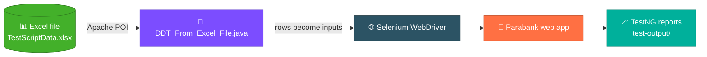
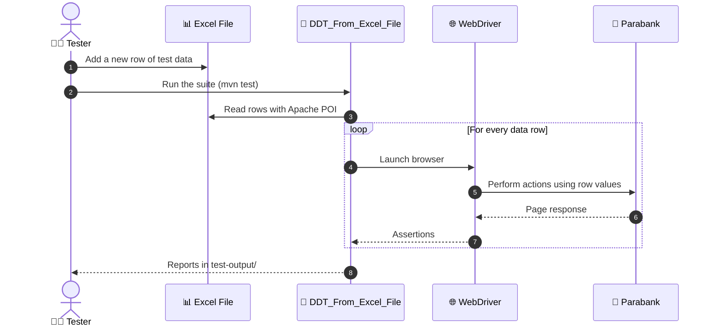

<div align="center">


<br/>


<br/>

**[📌 Overview](#-project-overview)** •
**[✨ Features](#-key-features)** •
**[🧰 Tech Stack](#-technology-stack)** •
**[📊 Data-Driven](#-how-data-driven-testing-works)** •
**[🏗️ Structure](#%EF%B8%8F-project-structure)** •
**[🚀 Setup](#-getting-started)** •
**[▶️ Run](#%EF%B8%8F-running-the-tests)** •
**[📈 Reports](#-test-reports)**

</div>


## 📌 Project Overview

**Parabank Automation** is a Selenium-based test automation framework for the **Parabank** web application, built with **Java, TestNG and Maven**.

Its main strength is **data-driven testing**: test inputs are stored in **Excel files** and read at run time with **Apache POI**, so the same test logic can run against many data sets without touching the code.

> 🎯 **Goal:** Keep test logic and test data separate, so tests stay clean, reusable and easy to extend.



---

## ✨ Key Features

<table>
<tr>
<td width="50%" valign="top">

### 📊 Data-Driven Testing
- 📁 Test data kept in Excel files
- 🔌 Read using Apache POI
- ➕ Add rows, not code
- ♻️ One test, many data sets

</td>
<td width="50%" valign="top">

### ⚙️ Automation Framework
- 🌐 Selenium WebDriver browser automation
- 🧪 TestNG test execution
- 📦 Maven dependency management
- 🗂️ Clear separation of pages, utilities and tests

</td>
</tr>
<tr>
<td width="50%" valign="top">

### 🧱 Organized Structure
- 📄 Page objects, utilities and base classes in `src/main/java`
- 🧪 Test classes in `src/test/java`
- 🗃️ Test data in `src/test/resources`
- 🧪 Suite controlled via `testng.xml`

</td>
<td width="50%" valign="top">

### 📈 Reporting
- 🌐 TestNG HTML reports
- 📄 XML execution results
- ✅ Pass / ❌ fail / ⏭️ skip tracking
- 📂 Generated in `test-output/`

</td>
</tr>
</table>

---

## 🧰 Technology Stack

| Technology | Purpose |
|:--|:--|
| ☕ **Java** | Programming language |
| 🧪 **TestNG** | Test framework and execution |
| 📦 **Maven** | Build tool and dependency management |
| 🌐 **Selenium WebDriver** | Browser automation |
| 📊 **Apache POI** | Reading Excel test data |
| 💻 **Eclipse IDE** | Development environment |

<details>
<summary><b>📚 Technology Resources (click to expand)</b></summary>
<br/>

- ☕ [Java Documentation](https://docs.oracle.com/en/java/)
- 🌐 [Selenium Documentation](https://www.selenium.dev/documentation/)
- 🧪 [TestNG Documentation](https://testng.org/doc/)
- 📦 [Apache Maven Guide](https://maven.apache.org/guides/)
- 📊 [Apache POI](https://poi.apache.org/)

</details>

---

## 📊 How Data-Driven Testing Works

Test data is read from Excel files in `src/test/resources/` by `DDT_From_Excel_File.java` using Apache POI.



**Adding a new scenario**

1. 📝 Open the Excel file in `src/test/resources/`
2. ➕ Add a new row with your data
3. ▶️ Run the suite, and the new row is picked up automatically

> 💡 No code changes are needed for new data sets.

---

## 🏗️ Project Structure

```text
parabank-automation/
│
├── 📂 src/
│   ├── 📂 main/java/                # Page objects, utilities, base classes
│   └── 📂 test/
│       ├── 📂 java/                 # Test classes (TestNG)
│       │   └── 📂 dataDrivenTesting/
│       │       └── 📊 DDT_From_Excel_File.java
│       └── 📂 resources/            # Test data files (e.g. TestScriptData.xlsx)
│
├── 📈 test-output/                  # TestNG execution reports
├── 🎯 target/                       # Compiled build output (ignored in Git)
├── 📦 pom.xml                       # Maven dependencies and build config
└── 🧪 testng.xml                    # TestNG suite configuration
```

| Folder / File | Responsibility |
|:--|:--|
| 📂 `src/main/java` | Page objects, utilities and base classes |
| 📂 `src/test/java` | TestNG test classes |
| 📊 `DDT_From_Excel_File.java` | Reads Excel data and drives the tests |
| 🗃️ `src/test/resources` | Excel test data files |
| 📦 `pom.xml` | Maven dependencies and build configuration |
| 🧪 `testng.xml` | TestNG suite configuration |
| 📈 `test-output/` | Generated execution reports |

---

## 🚀 Getting Started

### 📋 Prerequisites

| Requirement | Version |
|:--|:--|
| ☕ Java JDK | 8 or higher |
| 📦 Apache Maven | Installed and on your PATH |
| 💻 Eclipse IDE | With TestNG and EGit plugins |
| 🌍 Browser | Chrome or Firefox, plus matching WebDriver |

### ⚡ Setup

**1️⃣ Clone the repository**
```bash
git clone https://github.com/jancirani-testing/parabank-automation.git
cd parabank-automation
```

**2️⃣ Import into Eclipse**

1. **File → Import → Existing Maven Projects**
2. Select the cloned folder and click **Finish**

**3️⃣ Download dependencies**

Right-click the project → **Maven → Update Project**

**4️⃣ Update configuration**

Change values such as the base URL, credentials and file paths as needed.

---

## ▶️ Running the Tests

<table>
<tr>
<td width="50%" valign="top">

### 💻 Option 1: Eclipse

1. Open the project in Eclipse
2. Right-click `testng.xml`
3. Select **Run As → TestNG Suite**
4. Watch results in the TestNG console

</td>
<td width="50%" valign="top">

### ⌨️ Option 2: Maven

```bash
# Run the configured suite
mvn test

# Clean build, then test
mvn clean test
```

</td>
</tr>
</table>

> ⚠️ **Note:** Results depend on browser setup, application availability and configuration. Make sure the WebDriver matches your browser version.

---

## 📈 Test Reports

Reports are generated in the `test-output/` folder after each run.

```text
📁 test-output/
│
├── 🌐 index.html
├── 📧 emailable-report.html
├── 📄 testng-results.xml
└── 🗂️ other generated report files
```

| Report | Description |
|:--|:--|
| 🌐 `index.html` | TestNG execution summary |
| 📧 `emailable-report.html` | Email-friendly report |
| 📄 `testng-results.xml` | Structured XML results |

**👀 View results:** run the suite → open `test-output/` → open `index.html` in a browser → review ✅ passed, ❌ failed and ⏭️ skipped tests.

---

## 🔮 Future Enhancements

| Enhancement | Description | Status |
|:--|:--|:-:|
| 🧱 Page Object Model | Strengthen separation of page interactions and test logic |  |
| 📈 Extent Reports / Allure | Richer execution reports |  |
| 📸 Screenshot Capture | Capture screenshots for failed tests |  |
| 📝 Logging Framework | Better debugging and traceability |  |
| ⚡ Parallel Execution | Reduce execution time |  |
| 🤖 GitHub Actions | CI/CD pipeline for automatic runs |  |

---

## 🤝 Contributing

Contributions and suggestions are welcome! 💚

```bash
git checkout -b feature/your-feature-name
git commit -m "Add: your feature description"
git push origin feature/your-feature-name
```

Then open a **Pull Request** describing your changes.

---

## 👨‍💻 Author

<div align="center">

**Jancirani**

*QA Automation Tester* &nbsp;|&nbsp; ☕ Java &nbsp;|&nbsp; 🌐 Selenium WebDriver &nbsp;|&nbsp; 🧪 TestNG &nbsp;|&nbsp; 📊 Apache POI

<a href="https://github.com/jancirani-testing">
  
</a>

<br/><br/>

**⭐ If this project helped you, consider giving it a star!**


**Made with ☕ Java, 🧪 Selenium & ❤️ for Quality Assurance**

</div>
